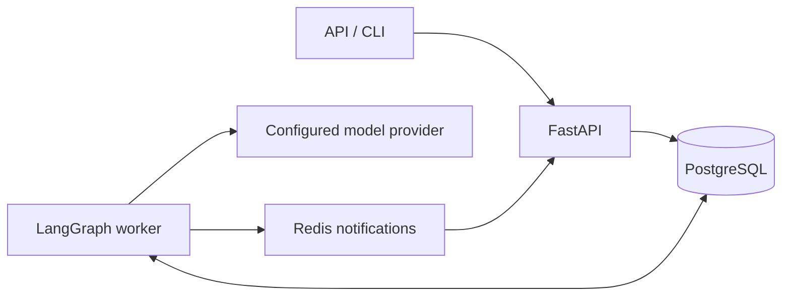

# Multi-Agent OS

**v0.1.0 — Early Source Preview.** Multi-Agent OS is a headless, self-hosted
Python runtime for typed multi-agent workflows. Define agents, deterministic
tools and approval steps in code, then operate runs through a FastAPI API or CLI.
This release publishes source code; no prebuilt Docker image or production
security approval is included.

- **FastAPI + LangGraph:** generic sequential workflow execution with validated
  inputs/outputs and versioned definitions.
- **Real model integrations:** Ollama, OpenAI-compatible endpoints, Groq,
  OpenRouter and Gemini. Operators select a reachable model and credentials.
- **PostgreSQL persistence:** durable jobs, node checkpoints, ordered events,
  approvals and authentication state. Redis supplies notification hints;
  PostgreSQL replay/polling preserves durable execution when Redis is unavailable.
- **Human control:** inspect the concrete result, approve/reject it, then
  explicitly resume. Approval alone does not schedule downstream execution.
- **Headless operations:** REST/WebSocket APIs, administrator/operator/viewer
  roles, migrations, readiness checks and a container-friendly Python CLI.



## Security Notice — Review Before Self-Hosting

This open-source software is intended for development, experimentation and
self-hosting. It has not been certified as secure for unrestricted public or
enterprise production deployment.

The recorded Docker runtime candidate uses **Debian Trixie**. Its latest recorded
local vulnerability scan contains unresolved OS findings, including **HIGH**
severity issues: **0 CRITICAL, 40 HIGH, 58 MEDIUM, 60 LOW and 1 UNKNOWN** across
OS and Python packages. Six HIGH CVEs have affected components present; other
HIGH rows include unresolved package attribution and concrete component-absence
evidence. These findings have not been reclassified as fixed. The image security
gate remains FAIL; source-preview publication is a separate owner decision.

Before deploying, modifying or exposing this application to the internet,
review the source, dependencies, container configuration, authentication,
secrets handling, network exposure and current security advisories for your
environment. Use supported base images and security updates where available;
**rebuild and rescan your own images**. Successful installation or tests do not
prove that a deployment is security-hardened.

Read [SECURITY.md](SECURITY.md) and the
[security signoff report](docs/release/SPEC-030-SECURITY-SIGNOFF.md) for findings,
mitigations and outstanding limitations. GitHub Private Vulnerability Reporting
is enabled (confirmed read-only for this repository); use
[Report a vulnerability](https://github.com/hzjanuary/multi-agent-system/security/advisories/new)
for private disclosure. Do not publish credentials or vulnerability details in
public issues.

## First installation

Prerequisites: Git, Docker Engine and Compose v2 or a compatible newer Compose,
and access to PostgreSQL/Redis images and Python package indexes during build.
The verified container runtime is Debian Trixie on Linux/amd64. Use a fresh,
isolated database; legacy product databases are not migrated automatically.
A selected model must already be installed/reachable, or be an explicitly
configured remote provider. Initialization does not download models or infer.

Build from the repository root so the canonical LICENSE/NOTICE are included:

```bash
git clone https://github.com/hzjanuary/multi-agent-system.git
cd multi-agent-system
mkdir -p .maos
chmod 700 .maos
docker build --file backend/Dockerfile --target runtime --build-arg VCS_REF="$(git rev-parse HEAD)" -t multi-agent-os:local .
docker run --rm \
  --user "$(id -u):$(id -g)" \
  --mount "type=bind,source=$(pwd)/.maos,target=/config" \
  multi-agent-os:local python -m app.cli config init --output /config/.env
```

On hosts where Docker bridge DNS cannot reach package indexes, the optional
build flag `--network=host` may be needed. Runtime uses the private Compose network.
For repeatable candidate checks, follow the [release checklist](docs/release/RELEASE-CHECKLIST.md).

Edit `.maos/.env` privately; preserve generated database/JWT secrets. For local
Ollama set `LLM_PROVIDER=ollama`, `LLM_MODEL` to an exact installed model name,
and `OLLAMA_BASE_URL` reachable **from containers**. On Linux the supplied
host-gateway mapping supports `http://host.docker.internal:11434` when Ollama
listens on a reachable, firewalled interface. The optional Compose `ollama`
profile uses `http://ollama:11434`; installing weights is an operator action.
See [providers](docs/providers.md) for remote endpoints and credential fields.

Enable the packaged example with
`MAOS_EXTENSION_MODULES=maos_examples.text_review`; Compose forwards the same
settings to API and worker. The default registry is empty. No accounts or runs
are seeded. Keep `.maos/`, provider keys and CLI sessions out of Git.

```bash
docker compose --env-file .maos/.env config --quiet
docker compose --env-file .maos/.env up -d --wait postgres redis
docker compose --env-file .maos/.env run --rm --no-deps api python -m app.cli migrate
docker compose --env-file .maos/.env run --rm --no-deps api python -m app.cli admin bootstrap
docker compose --env-file .maos/.env up -d --wait api worker
docker compose --env-file .maos/.env exec api python -m app.cli doctor
docker compose --env-file .maos/.env --profile cli run --rm cli auth login
docker compose --env-file .maos/.env --profile cli run --rm cli workflow list
```

Bootstrap prompts locally for email/password and refuses to reset an existing
installation. Login creates `.maos/cli/auth.json` (0600) for separate CLI
containers; API/worker do not mount it. Use `config --quiet` to avoid printing
resolved secrets. The API is published at `127.0.0.1:8000`; PostgreSQL/Redis have
no host ports. Keep the default non-root, dropped-capabilities and
no-new-privileges settings.

## Example: two-agent text review with approval

`text_review@1.0.0` runs Analyst → Reviewer → WAITING_APPROVAL → explicit approval
→ explicit resume → pure final assembly. Reviewer receives the analyst's
validated output. Model calls use the configured provider; running this example
may send text to that provider and consume its resources.

Create `.maos/cli/input.json` with your own non-sensitive text, for example
`{"text":"Your text here"}`. Create a run and use its returned ID:

```bash
docker compose --env-file .maos/.env --profile cli run --rm cli run create text_review --version 1.0.0 --input /cli/input.json --idempotency-key my-text-1
docker compose --env-file .maos/.env --profile cli run --rm cli run start <run-id>
docker compose --env-file .maos/.env --profile cli run --rm cli run events <run-id> --follow
docker compose --env-file .maos/.env --profile cli run --rm cli run nodes <run-id>
docker compose --env-file .maos/.env --profile cli run --rm cli run approvals <run-id>
```

Read the pending content, approval ID, `content_hash`, `content_revision` and
current run `revision`. Replace all angle-bracket placeholders:

```bash
docker compose --env-file .maos/.env --profile cli run --rm cli run approve <run-id> <approval-id> --expected-revision <revision> --content-revision <content-revision> --content-hash <content-hash>
docker compose --env-file .maos/.env --profile cli run --rm cli run resume <run-id>
docker compose --env-file .maos/.env --profile cli run --rm cli run show <run-id>
```

Final assembly adds no model call. `run reject` uses the same identity arguments;
`run cancel` persists cancellation. See [API/CLI operations](docs/api.md).
The CLI also offers `--help`, `workflow show`, `workflow validate` and `--json`.

## API, configuration and operations

API documentation: [localhost /docs](http://127.0.0.1:8000/docs); schema:
`/openapi.json`. REST/WebSocket clients use Authorization headers, never tokens
in URLs. Discover definitions at `GET /api/v1/workflows` and `/api/v1/agents`;
create runs at `POST /api/v1/runs`. Start/resume durably submit work. Inspect
outputs, approvals and ordered events; replay supports `after_sequence`.

[Configuration](docs/configuration.md) covers limits, timeouts, retries and
secrets; `.env.example` is the safe reference. Provider/model identity is pinned
per run. User inputs/validated outputs persist in PostgreSQL; prompts/raw
provider bodies are not application logs. Default OpenRouter preferences deny
collection and require ZDR. Explicit private test profiles do not change those
defaults. Provider/model terms govern remote processing: self-hosting this app
does not make a remote model local or guarantee confidential processing.

Stop with `docker compose --env-file .maos/.env stop`; named volumes retain data.
Back up database and configuration separately and test restore before upgrades.
Recovery uses explicit resume and can repeat an uncommitted remote call; consumed
reservations remain durable. Non-idempotent uncertain actions require external
reconciliation. See [self-hosting](docs/self-hosting.md) and [migration](docs/migration.md).

This is one trusted instance: readers can access all runs and installed Python
extensions have worker privileges. There is no tenant isolation, SSO, built-in
login throttling or untrusted-extension sandbox. For internet exposure, supply
TLS/reverse proxy, access/rate/body limits, safe logs and tested backups.

## Verification, extensions and contributing

**SPEC-029: 32 PASS / 0 BLOCKED.** The recorded direct Groq
`openai/gpt-oss-20b` journey completed two real chained calls, durable outputs/
events, approval, explicit resume and final assembly. That evidence belongs to
its recorded source/image; it is not security clearance for later images.
Cloudflare Workers AI is configured/offline-tested, **not live-verified**.
Other provider/model deployments need their own validation. Historical smoke
campaigns are closed and their budgets must not be reused.

See [acceptance evidence](docs/release/verification.md),
[extending workflows](docs/extending.md) and [CONTRIBUTING](CONTRIBUTING.md).
Tests use test-only doubles; no fake production provider is selectable. The
source-preview tag `v0.1.0` identifies this publication milestone; the retained
CLI/package version is `0.2.0` from the headless implementation.

## License and history

Project-owned code is [MIT licensed](LICENSE); read [NOTICE](NOTICE) and the
[third-party license inventory](docs/release/RELEASE-CHECKLIST.md). Python, base
OS, infrastructure and model/provider terms are independent. Redis 7.4 is
source-available under RSALv2/SSPLv1; the whole deployment is not MIT/OSI-only.

The former procurement/frontend/RAG/Telegram demo is retired, preserved only in
Git history and explicitly historical documents. It is not the current product
or an installation dependency. Existing legacy data/volumes are not deleted or
migrated. See [CHANGELOG](CHANGELOG.md), [architecture](docs/architecture.md) and
[the source-preview decision](docs/release/v0.1.0-source-preview.md).
