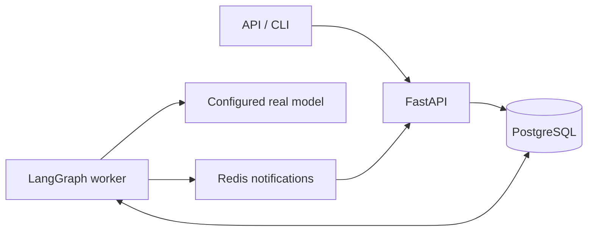

# Multi-Agent OS

Multi-Agent OS is a headless, self-hosted runtime for building and running typed
multi-agent workflows. It combines real model-provider integrations, durable run
state, human approval, and an API/CLI interface.

This is a breaking pre-1.0 extraction of a university graduation project.
Consult the [acceptance evidence](docs/release/verification.md) for the exact
verified revision, commands and remaining release gates. Passing fixture tests
is not proof of live model inference.

- Code-first sequential workflows with typed agents, deterministic tools and
  explicit human approval gates.
- PostgreSQL-backed jobs, fenced worker ownership, per-node commits and ordered
  events. Redis provides notification hints; database polling preserves replay.
- FastAPI REST/WebSocket interfaces, Argon2/JWT authentication, generic
  admin/operator/viewer roles, and the `python -m app.cli` operator CLI.
- Real Ollama, OpenAI-compatible, Groq, OpenRouter and Gemini transports.

One trusted single-host instance is supported. Installed extensions have worker
privileges. This release has no UI, RAG, vector memory, messaging, arbitrary code
submission, autonomous planner, arbitrary DAGs, distributed scheduling or sandbox
for untrusted extensions. Interrupted non-idempotent actions require independent
reconciliation; exactly-once external effects are not promised.



## First installation

The primary target is Linux with Docker Engine and Compose v2 or compatible
newer Compose. No Node.js is required. An operator-selected model must already be
installed/reachable; initialization does not download weights or call inference.
Exact tested host/tool versions and verification status are in the evidence file.
Use a checkout containing the headless commits. The public clone command below
is a manual distribution example until those commits are published; verification
used an independent local clone of the exact revision in the evidence file.
The verified Linux build uses host networking to reach package indexes on this
host. Runtime services use the private Compose network.

```bash
git clone https://github.com/hzjanuary/multi-agent-system.git
cd multi-agent-system
mkdir -p .maos
chmod 700 .maos
docker build --network=host --target runtime -t multi-agent-os:local ./backend
docker run --rm \
  --user "$(id -u):$(id -g)" \
  --mount "type=bind,source=$(pwd)/.maos,target=/config" \
  multi-agent-os:local python -m app.cli config init --output /config/.env
```

Edit `.maos/.env` privately. Keep the generated database/JWT secrets. Set
`LLM_PROVIDER=ollama`, `LLM_MODEL` to an installed model's exact name, and
`OLLAMA_BASE_URL` to an endpoint reachable **from the containers**. To use the
example, set `MAOS_EXTENSION_MODULES=maos_examples.text_review` on both services.
The default registry is empty. No account, run or example activity is seeded.

For an existing host Ollama on Linux, `http://host.docker.internal:11434` uses the
Compose host-gateway mapping. Ollama must listen on a reachable interface; limit
access with host networking/firewall configuration. Alternatively enable the
optional `ollama` profile and use `http://ollama:11434`; model installation
is an explicit operator step. See [providers](docs/providers.md).

```bash
docker compose --env-file .maos/.env config --quiet
docker compose --env-file .maos/.env up -d --wait postgres redis
docker compose --env-file .maos/.env run --rm --no-deps api python -m app.cli migrate
docker compose --env-file .maos/.env run --rm --no-deps api python -m app.cli admin bootstrap
docker compose --env-file .maos/.env up -d api worker
docker compose --env-file .maos/.env exec api python -m app.cli doctor
docker compose --env-file .maos/.env --profile cli run --rm cli auth login
docker compose --env-file .maos/.env --profile cli run --rm cli workflow list
```

Bootstrap prompts for your email/password and refuses to reset or re-grant an
existing installation. Login stores credentials in `.maos/cli/auth.json` (0600)
shared by separate CLI containers. API and worker do not mount that directory.
Keep `.maos` private and out of Git. Access tokens expire independently after
logout; refresh sessions are stored as digests, rotated and revoked.

## Execute your text

The model-dependent commands in this section are manual deployment examples
pending AC-08. The maintainer chose to keep live inference blocked for this
verification pass; the release evidence separates those commands from the
verified installation and CLI checks.

Create `.maos/cli/input.json` with your own text: `{"text":"your text here"}`.
There are no bundled answers. `text_review` chains an analyst agent into a
reviewer agent, then pauses for approval of the concrete result.

```bash
docker compose --env-file .maos/.env --profile cli run --rm cli run create text_review --version 1.0.0 --input /cli/input.json --idempotency-key my-text-1
```

Use the returned run ID below; replace all angle-bracket placeholders.

```bash
docker compose --env-file .maos/.env --profile cli run --rm cli run start <run-id>
docker compose --env-file .maos/.env --profile cli run --rm cli run events <run-id> --follow
docker compose --env-file .maos/.env --profile cli run --rm cli run show <run-id>
docker compose --env-file .maos/.env --profile cli run --rm cli run nodes <run-id>
docker compose --env-file .maos/.env --profile cli run --rm cli run approvals <run-id>
```

Read the pending content, its `content_hash`, `content_revision`, approval ID and
current run `revision`. Approving never schedules downstream execution by itself.

```bash
docker compose --env-file .maos/.env --profile cli run --rm cli run approve <run-id> <approval-id> --expected-revision <revision> --content-revision <content-revision> --content-hash <content-hash>
docker compose --env-file .maos/.env --profile cli run --rm cli run resume <run-id>
docker compose --env-file .maos/.env --profile cli run --rm cli run show <run-id>
```

The final pure tool assembles validated results after explicit resume. Reject with
`run reject` using the same identity arguments. `run cancel` reports the persisted
state: a running cancellation is a request until the worker reaches a boundary.
`--json` before the command group selects machine-readable output.

## API and CLI

The API binds to `127.0.0.1:8000`. Generated documentation is at
[localhost /docs](http://127.0.0.1:8000/docs); schema is `/openapi.json`.
Use `Authorization: Bearer` for REST and WebSocket handshakes. Tokens in URLs are
not supported. All run details are visible to authenticated instance readers;
this is not per-owner tenant isolation.

`GET /api/v1/workflows` and `/agents` discover definitions. Create runs at
`POST /api/v1/runs`; start/resume return 202 after durable submission. Node
outputs, approvals and events have bounded detail endpoints. Event replay uses
`after_sequence`; WebSocket streams catch up from PostgreSQL even if Redis is
unavailable. See [API](docs/api.md) and CLI `--help`.

Errors have stable codes: invalid input/definition 422, missing authentication
401, denied role 403, missing run 404, transition/idempotency/approval conflict
409, configuration/storage unavailability 503. Async model failure is a persisted
FAILED run. It never becomes fixture success.

## Configuration and operations

[Configuration](docs/configuration.md) documents required values, defaults,
limits and secrets; `.env.example` is the public reference. The model/provider
identity is pinned per run. Rotating credentials is allowed; rerouting an existing
run to another profile is blocked. Remote inference sends inputs to that provider.
User inputs and validated outputs are stored in PostgreSQL; prompts and raw model
responses are not application logs. No telemetry is enabled.

Stop with `docker compose --env-file .maos/.env stop`; restart with `up -d api
worker`. Named volumes preserve data. Expired worker claims become INTERRUPTED;
recovery requires explicit `run resume`, may repeat an uncommitted model call,
and retains consumed call reservations. Committed nodes do not repeat.

Before upgrading, back up the database and configuration separately. Restore to
a separate instance and test it before changing images. Detailed commands,
legacy refusal rules, restore and upgrade procedures are in
[self-hosting](docs/self-hosting.md) and [migration](docs/migration.md).
Never point the new migration command at an old procurement database.

## Extensions, development and verification

[Extending](docs/extending.md) describes Pydantic schemas, mappings, immutable
versions/artifact fingerprints, agent/tool effects and approval boundaries. Enable
only trusted installed Python modules through `MAOS_EXTENSION_MODULES`.
The included package is `backend/maos_examples/text_review.py`; unrelated workflow
integration tests exercise the same engine without core modifications.

See [CONTRIBUTING](CONTRIBUTING.md) for locked Python setup, backend-only quality
gates and isolated database tests. Default tests use injected test-only provider
fixtures. The following bounded live probe is a manual deployment example pending AC-08:

```bash
docker compose --env-file .maos/.env exec api python -m app.cli provider check --max-calls 1 --max-tokens 128
```

Remote probes additionally require `--enable-remote`. This probe does not prove
the two-agent workflow; release evidence tracks that separate live smoke gate.
Do not infer live compatibility from adapter contract tests.

## Legacy and project policies

This release removes the graduation web/procurement application, seeded accounts,
catalogs, RAG/Qdrant/MinIO, pricing, outbound previews and Telegram features.
Existing data/volumes are not migrated or deleted. Use the baseline
`92e5f1cfb2b0144bdb39a48db99371974bd372a5` with its original isolated stack to
inspect legacy data. See [CHANGELOG](CHANGELOG.md).

[Contributing](CONTRIBUTING.md) · [Security](SECURITY.md) · [MIT license](LICENSE)
· [Notices](NOTICE) · [Architecture](docs/architecture.md)

The project originated as a university graduation project; the headless release
retains that provenance while replacing its demonstration product contract.
